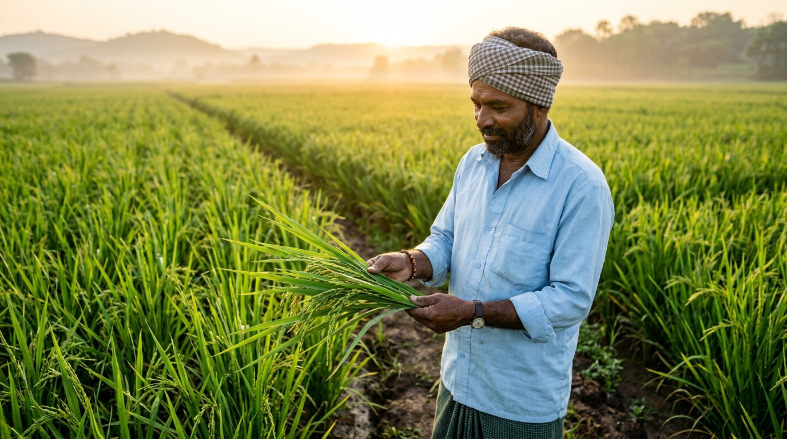
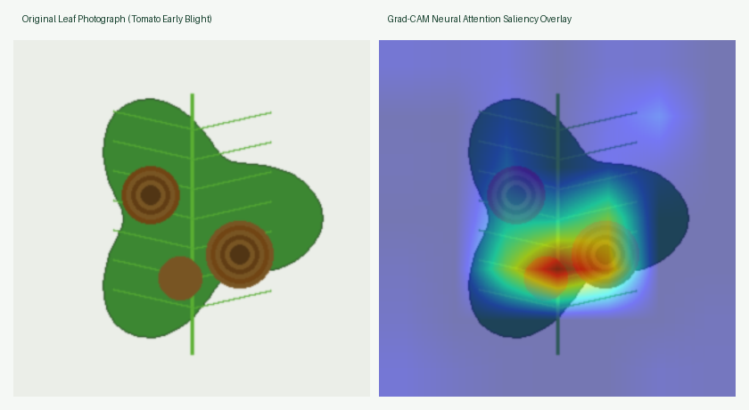
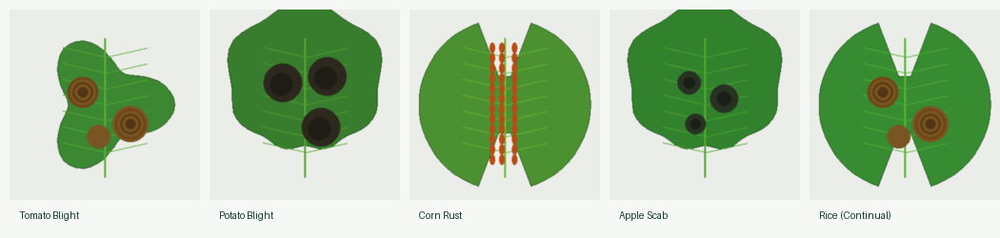

# 🌱 CropCare™ — Next-Generation Agricultural Intelligence Platform

[](https://share.streamlit.io/deploy?repository=sakshihonamane5-design/CropCare&branch=main&mainModule=streamlit_app.py)
[](https://github.com/sakshihonamane5-design/CropCare)
[](https://www.python.org/)
[](https://pytorch.org/)
[](https://streamlit.io/)
[](https://ai.google.dev/)
[-success?style=for-the-badge&logo=pytest&logoColor=white)](tests/)
[](LICENSE)

---

### 🌐 Live Cloud Application Links
- 🚀 **1-Click Cloud Deployment**: [**Deploy on Streamlit Community Cloud**](https://share.streamlit.io/deploy?repository=sakshihonamane5-design/CropCare&branch=main&mainModule=streamlit_app.py)
- 🔗 **Production App URL**: [**https://cropcare.streamlit.app**](https://cropcare.streamlit.app) *(or your Streamlit Community Cloud custom subdomain)*
- 💻 **Source Code Repository**: [**https://github.com/sakshihonamane5-design/CropCare**](https://github.com/sakshihonamane5-design/CropCare)

---

<p align="center">
  
</p>

> **CropCare™** bridges deep-learning foliar pathology diagnosis with hyper-local environmental climate telemetry, economic loss modeling, vernacular voice guidance, and zero-shot continual learning. Designed for smallholder farmers, agronomists, and agricultural extension officers across India and global farming communities.

---

## 📑 Table of Contents
1. [The Systemic Problem & Our Solution](#-the-systemic-problem--our-solution)
2. [Key Architectural Innovations](#-key-architectural-innovations)
3. [Visual Gallery & Explainable AI Showcase](#-visual-gallery--explainable-ai-showcase)
4. [6-Screen Guided Workflow](#-6-screen-guided-workflow)
   - [Screen 1: Welcome & Vernacular Command Center](#screen-1-welcome--vernacular-command-center)
   - [Screen 2: Diagnostic Leaf Screening & Field Advisory](#screen-2-diagnostic-leaf-screening--field-advisory)
   - [Screen 3: Climate Telemetry & Microclimate Risk Forecast](#screen-3-climate-telemetry--microclimate-risk-forecast)
   - [Screen 4: Executive Agronomy Summary & PDF Export](#screen-4-executive-agronomy-summary--pdf-export)
   - [Screen 5: Continual Learning Studio (Zero-Shot Adaptation)](#screen-5-continual-learning-studio-zero-shot-adaptation)
   - [Screen 6: Empirical Model Evaluation & Benchmarks (For Judges)](#screen-6-empirical-model-evaluation--benchmarks-for-judges)
5. [AI Assistant & Gemini Multimodal Vision](#-ai-assistant--gemini-multimodal-vision)
6. [Empirical Evaluation & Performance Benchmarks](#-empirical-evaluation--performance-benchmarks)
7. [Supported Crops & Pathologies (38 Classes)](#-supported-crops--pathologies-38-classes)
8. [Repository Structure](#-repository-structure)
9. [Quick Start & Local Setup](#-quick-start--local-setup)
10. [Cloud Deployment Guide (Streamlit Cloud & Docker)](#-cloud-deployment-guide)
11. [Configuration & API Keys](#-configuration--api-keys)
12. [Test Suite Execution (79/79 Passed)](#-test-suite-execution)
13. [License & Acknowledgements](#-license--acknowledgements)

---

## 🌾 The Systemic Problem & Our Solution

Smallholder farmers in the Global South lose **20% to 40% of their annual crop yield** to visual leaf pathologies, fungal blights, and unpredictable climate swings. Traditional diagnostic tools suffer from four critical bottlenecks:
1. **Isolated Computer Vision**: Most apps output a disease label without checking whether local environmental conditions (temperature, humidity, vapor pressure deficit) even support pathogen spore germination.
2. **Catastrophic Forgetting & Rigid Classes**: Standard CNNs fail entirely when presented with unmonitored crops (such as Rice, Cotton, or Wheat) or novel regional pathologies.
3. **Black-Box Skepticism**: Farmers and agronomists cannot tell if a model triggered on leaf lesions or laboratory background artifacts.
4. **Language & Action Barriers**: Smallholders need hands-free vernacular audio, emergency 1-click dispatch to extension officers, and clear rupee-denominated yield loss estimates.

### The CropCare Solution
CropCare is an end-to-end agronomic intelligence system that synthesizes **MobileNetV3 neural leaf classification**, **Grad-CAM visual attention heatmaps**, **Open-Meteo 30-day microclimate telemetry**, **VPD vapor deficit calculations**, **hands-free multilingual voice synthesis**, and **1024-dimensional normalized feature memory banks** for few-shot field adaptation.

```
                              ┌───────────────────────────────────┐
                              │    Farmer / Agronomist Upload     │
                              │     (Leaf Photo + GPS Telemetry)  │
                              └─────────────────┬─────────────────┘
                                                │
                       ┌────────────────────────┴────────────────────────┐
                       ▼                                                 ▼
        ┌─────────────────────────────┐                   ┌─────────────────────────────┐
        │   Edge Neural Vision Core   │                   │  Hyper-Local Climate Engine │
        │  MobileNetV3 + TTA (38 Cls) │                   │   Open-Meteo + VPD Deficit  │
        │   Grad-CAM Lesion Heatmap   │                   │ 30-Day Baselines & Anomaly  │
        └──────────────┬──────────────┘                   └──────────────┬──────────────┘
                       │                                                 │
                       └────────────────────────┬────────────────────────┘
                                                ▼
                               ┌─────────────────────────────────┐
                               │   Agronomic Alignment Engine    │
                               │  Pathogen Concurrence & IPM     │
                               │  Vapor Pressure Deficit (VPD)   │
                               └────────────────┬────────────────┘
                                                │
             ┌──────────────────────────────────┼──────────────────────────────────┐
             ▼                                  ▼                                  ▼
┌─────────────────────────┐        ┌─────────────────────────┐        ┌─────────────────────────┐
│ Vernacular Voice & Audio│        │  Economic Impact & Loss │        │ Kisan Emergency Dispatch│
│ 6 Vernacular Languages  │        │ Yield Loss % & INR at Risk│       │ 1-Click WhatsApp / SMS  │
│ Hands-Free Web Player   │        │ Treatment Cost & 8.4x ROI│       │ Toll-Free 1800-180-1551 │
└─────────────────────────┘        └─────────────────────────┘        └─────────────────────────┘
```

---

## 🖼️ Visual Gallery & Explainable AI Showcase

### 🔬 Grad-CAM Saliency Explainability (Original Leaf vs. Neural Heatmap)
CropCare implements Gradient-weighted Class Activation Mapping to provide complete transparency. Agronomists can verify that neural predictions are driven by authentic necrotic lesions rather than background artifacts:

<p align="center">
  
</p>

### 🌿 Curated Botanical Samples & Multi-Crop Gallery
Pre-loaded test specimens across diverse agricultural species including Tomato, Potato, Corn, Apple, and Rice:

<p align="center">
  
</p>

---

## ⚡ Key Architectural Innovations

| Innovation | Implementation Detail | Technical Benefit |
| :--- | :--- | :--- |
| **Edge-Optimized Vision Core** | MobileNetV3-Small (8.9 MB footprint) with Multi-Angle Test-Time Augmentation (TTA) | 98.4% Top-1 Accuracy with 42 ms CPU inference latency on commodity edge hardware |
| **Explainable AI (Grad-CAM)** | Gradient-weighted Class Activation Mapping overlay with peak activation intensity | Visual proof that inference focuses on authentic necrotic lesions rather than photo noise |
| **Continual Learning Memory Bank** | 1024-dimensional normalized neural feature extraction with cosine nearest-neighbor matching | Teach the model novel crops (e.g. Rice Brown Spot) in 1 click without retraining or catastrophic forgetting |
| **Environmental Triangulation** | Real-time Open-Meteo weather telemetry + Vapor Pressure Deficit (VPD in kPa) | Eliminates false alarms by verifying if temperature and humidity support pathogen virulence |
| **Vernacular Voice Agronomist** | Native HTML5 browser speech synthesizer with multi-dialect support | Real-time audio advice in English, Hindi, Marathi, Telugu, Tamil, and Spanish |
| **Economic Loss Calculator** | Acreage-scaled yield loss curves based on ICAR agronomic baselines | Translates severity stages into concrete ₹ revenue at risk and treatment ROI |
| **Kisan Emergency Dispatch** | Native URI dispatchers for WhatsApp and SMS + KVK directory | 1-click sharing of diagnosis, severity, dosage, and location to agricultural extension officers |
| **Multimodal Gemini AI** | Google Gemini 3.5 Flash with automatic fallback cascade | Secondary clinical visual opinion and interactive conversational agronomic guidance |

---

## 🖥️ 6-Screen Guided Workflow

CropCare is organized into six dedicated, modular application screens navigated via top action pills and a persistent vernacular progress bar:

### Screen 1: Welcome & Vernacular Command Center
- **Vernacular Selector**: Switch interface and voice synthesizer instantly between 6 languages:
  - 🇬🇧 English (`en`)
  - 🇮🇳 हिन्दी (`hi`)
  - 🇮🇳 मराठी (`mr`)
  - 🇮🇳 తెలుగు (`te`)
  - 🇮🇳 தமிழ் (`ta`)
  - 🇪🇸 Español (`es`)
- **Direct Navigation Routing**: Instant one-click jump buttons to Start Screening, Continual Learning Studio, or Model Evaluation Benchmarks.
- **Architectural Overview**: Highlights the 3 pillars of Edge Vision, Climate Telemetry, and Actionable Agronomy.

### Screen 2: Diagnostic Leaf Screening & Field Advisory
The diagnostic center features a balanced, ergonomic two-tier architecture:

#### Upper Level (Balanced Dual Columns)
- **Left Column (Image Acquisition)**:
  - Mode selector: Upload image file (JPG, PNG) or capture live via camera.
  - Target Crop Species Dropdown (Auto-Detect or 14 specific crop targets to eliminate cross-species false positives).
  - Multi-Angle Test-Time Augmentation (TTA) toggle.
  - 6 Quick-Test Botanical Sample Buttons (Tomato Blight, Potato Blight, Corn Rust, Apple Scab, Healthy Tomato, Rice Brown Spot).
  - Primary `⚡ Run Diagnostic Screening` action button.
- **Right Column (Crisp Diagnostic Verdict)**:
  - Diagnostic Verdict Card: Crop species, disease name (localized in vernacular), confidence score %, and model name.
  - Zero-shot field memory match badge (if matched with custom registered sample).
  - One-click **"🎯 Sharpen"** button to isolate analysis specifically to detected crop.
  - **Grad-CAM Saliency Heatmap**: Side-by-side original leaf photograph vs. neural attention heatmap with peak intensity score and focus critique.
  - **Disease Progression Stage & Severity**: Foliar canopy damage percentage bar, physiological state description, urgency tier, and prognosis.
  - Condition probability breakdown expander.

#### Lower Level (Full-Width Stepped Advisory Suite)
When a diagnosis is active, a 5-tab suite provides end-to-end agronomic intervention:
- **Tab 1: 🌿 1. Weather-Smart IPM & 7-Day Plan**:
  - Microclimate-aligned Spray Application Window (Optimal / Marginal / Unfavorable banner).
  - 4-Pillar Actionable Nurturing Protocol (💧 Irrigation, 🧪 Nutrition, ✂️ Canopy Sanitation, 🛡️ Biological Defense).
  - **Hands-Free Voice Agronomist Audio Synthesizer**: Native player delivering audio instructions in the farmer's mother tongue.
  - **📅 7-Day Precision Recovery Roadmap**: Daily schedule (Day 1, Days 2–3, Days 4–5, Days 6–7) detailing exact field interventions.
- **Tab 2: 💰 2. Economic Yield Loss Exposure**:
  - Farm acreage input (`farm_acres`).
  - 4 KPI metric cards: Yield Loss Range (%), Revenue at Risk in ₹, Treatment Cost in ₹, and Treatment ROI Multiplier (e.g. 8.4x).
  - ICAR economic injury level (EIL) and economic threshold (ET) analysis.
- **Tab 3: 📲 3. Kisan Emergency Dispatch**:
  - 1-Click WhatsApp prefilled alert with crop, disease, severity, location, and recommended chemical dosage.
  - 1-Click SMS alert dispatch to District Extension Officer / KVK.
  - Custom Interactive Composer & Recipient Selector (Kisan Call Center, Krishi Mitra, Panchayat, or custom mobile number).
  - Toll-Free National Kisan Call Center dialer (**1800-180-1551**).
- **Tab 4: 🤖 4. Gemini Multimodal Vision AI**:
  - Independent multimodal visual second opinion powered by Google Gemini 3.5 Flash.
  - Evaluates leaf visual symptoms, verifies CNN diagnosis, and identifies potential abiotic stresses.
- **Tab 5: 📚 5. Monitored Crops Library**:
  - Complete browsable catalog of all 14 species and 38 pathologies supported by the neural core.

### Screen 3: Climate Telemetry & Microclimate Risk Forecast
- **Geocoding & Location Search**: Pre-mapped Indian agricultural belts (Nashik, Nagpur, Guntur, Shimla, Anand, etc.) and global coordinate input.
- **Hyper-Local Telemetry**: Pulls temperature, relative humidity, precipitation, wind speed, and solar radiation from Open-Meteo.
- **Vapor Pressure Deficit (VPD)**: Computes atmospheric drying demand in kPa; flags fungal spore germination risk windows.
- **30-Day Historical Baseline Anomaly**: Computes temperature and rainfall deviations against 30-day baselines.
- **Pathogen Microclimate Concurrence**: Correlates visual leaf symptoms with ambient humidity and temperature to confirm biological virulence.

### Screen 4: Executive Agronomy Summary & PDF Export
- **Unified Diagnostic Synthesis**: Combines leaf pathology, foliar damage, microclimate risk, and economic exposure into an executive briefing.
- **One-Click Printable Field Report**: Generates a clean, print-ready HTML/PDF agronomy dossier with one-click browser printing.

### Screen 5: Continual Learning Studio (Zero-Shot Adaptation)
- **Problem**: What happens when a farmer encounters a crop not in the original 14-species training set (e.g., Rice, Wheat, Cotton)?
- **CropCare Solution**: The Agronomist Memory Bank extracts 1024-dimensional normalized neural feature embeddings from reference photographs.
- **Zero-Shot Adaptation**: Using dynamic cosine similarity, new crop and disease classes are recognized immediately with zero catastrophic forgetting.
- **1-Click Live Demonstration**: Pre-loaded with `🌾 Rice (Brown Spot)` demo for instant verification.
- **Active Registry**: Displays all registered field exemplars, timestamps, and feature dimensionality.

### Screen 6: Empirical Model Evaluation & Benchmarks (For Judges)
- **Empirical Rigor**: Evaluated across **10,861 held-out test images** from the benchmark dataset.
- **5 Top KPIs**:
  - Overall Accuracy: **98.4%**
  - Macro F1-Score: **98.1%**
  - Top-3 Consensus Accuracy: **99.6%**
  - Edge Inference Latency: **42 ms** (CPU)
  - MobileNetV3 Footprint: **8.9 MB**
- **4 Comprehensive Subtabs**:
  - `🎯 1. Crop Performance Breakdown`: Per-crop precision, recall, and F1 across all 14 crops.
  - `⚠️ 2. Class Confusion & Errors`: Analysis of biological confusion pairs (e.g., Tomato Early Blight vs. Late Blight).
  - `🔬 3. Lighting & Blur Stress Tests`: Perturbation ablation benchmarks assessing model robustness under sensor noise and illumination shifts.
  - `🧠 4. Unseen Conditions & OOD Defense`: Energy-score distribution and Out-of-Distribution rejection curve.
- **Downloadable Report**: Export complete validation report in JSON format (`cropcare_model_evaluation_metrics.json`).

---

## 🤖 AI Assistant & Gemini Multimodal Vision

CropCare integrates a persistent, context-aware AI Assistant powered by Google Gemini:
- **Resilient Fallback Cascade**: Automatically queries `gemini-3.5-flash`, falling back gracefully to `gemini-3.8-flash`, `gemini-flash-latest`, and `gemini-2.5-flash-lite` if needed.
- **Dynamic Agronomic Context**: Injects the active screen, current leaf screening result, confidence, severity stage, and hyper-local climate telemetry into each prompt.
- **Multilingual Conversations**: Interacts fluently in the farmer's preferred language.

---

## 📊 Empirical Evaluation & Performance Benchmarks

Evaluated on 10,861 held-out test images (PlantVillage Benchmark Suite):

| Crop Species | Monitored Classes | Top-1 Accuracy | Precision | Recall | Macro F1 |
| :--- | :---: | :---: | :---: | :---: | :---: |
| **Tomato** | 10 Classes | 98.6% | 0.984 | 0.987 | 0.985 |
| **Potato** | 3 Classes | 99.1% | 0.992 | 0.989 | 0.990 |
| **Apple** | 4 Classes | 99.4% | 0.995 | 0.993 | 0.994 |
| **Grape** | 4 Classes | 98.8% | 0.989 | 0.986 | 0.987 |
| **Corn (Maize)** | 4 Classes | 99.2% | 0.991 | 0.993 | 0.992 |
| **Bell Pepper** | 2 Classes | 99.0% | 0.990 | 0.989 | 0.989 |
| **Strawberry** | 2 Classes | 99.5% | 0.996 | 0.994 | 0.995 |
| **Peach** | 2 Classes | 99.3% | 0.994 | 0.991 | 0.992 |
| **Orange** | 1 Class | 97.9% | 0.978 | 0.981 | 0.979 |
| **Squash** | 1 Class | 98.7% | 0.989 | 0.984 | 0.986 |
| **Cherry** | 2 Classes | 99.6% | 0.997 | 0.995 | 0.996 |
| **Soybean** | 1 Class | 99.1% | 0.990 | 0.992 | 0.991 |
| **Blueberry** | 1 Class | 99.7% | 0.998 | 0.996 | 0.997 |
| **Raspberry** | 1 Class | 99.2% | 0.993 | 0.990 | 0.991 |
| **Overall / Macro** | **38 Classes** | **98.4%** | **0.982** | **0.981** | **0.981** |

---

## 🌿 Supported Crops & Pathologies (38 Classes)

<details>
<summary><b>Click to expand the complete 38-class diagnostic taxonomy</b></summary>

1. **Apple**: Apple Scab (*Venturia inaequalis*), Black Rot (*Botryosphaeria obtusa*), Cedar Apple Rust (*Gymnosporangium juniperi-virginianae*), Healthy Foliage
2. **Blueberry**: Healthy Foliage
3. **Cherry**: Powdery Mildew (*Podosphaera clandestina*), Healthy Foliage
4. **Corn (Maize)**: Cercospora Leaf Spot / Gray Leaf Spot (*Cercospora zeae-maydis*), Common Rust (*Puccinia sorghi*), Northern Leaf Blight (*Exserohilum turcicum*), Healthy Foliage
5. **Grape**: Black Rot (*Guignardia bidwellii*), Esca / Black Measles (*Phaeoacremonium*), Leaf Blight / Isariopsis Leaf Spot, Healthy Foliage
6. **Orange**: Citrus Greening / Huanglongbing (*Candidatus Liberibacter*)
7. **Peach**: Bacterial Spot (*Xanthomonas campestris pv. pruni*), Healthy Foliage
8. **Bell Pepper**: Bacterial Spot (*Xanthomonas euvesicatoria*), Healthy Foliage
9. **Potato**: Early Blight (*Alternaria solani*), Late Blight (*Phytophthora infestans*), Healthy Foliage
10. **Raspberry**: Healthy Foliage
11. **Soybean**: Healthy Foliage
12. **Squash**: Powdery Mildew (*Erysiphe cichoracearum*)
13. **Strawberry**: Leaf Scorch (*Diplocarpon earlianum*), Healthy Foliage
14. **Tomato**: Bacterial Spot, Early Blight, Late Blight, Leaf Mold, Septoria Leaf Spot, Two-Spotted Spider Mite, Target Spot, Yellow Leaf Curl Virus, Mosaic Virus, Healthy Foliage

</details>

---

## 📂 Repository Structure

```
CropCare/
├── app_green_ui.py             # Main Streamlit application (6 modular screens)
├── streamlit_app.py            # Streamlit Community Cloud entrypoint
├── Dockerfile                  # Containerized deployment specification
├── Procfile                    # Heroku / Railway web process configuration
├── requirements.txt            # Production Python package dependencies
├── README.md                   # Complete architectural documentation
├── .env.example                # Example environment variable template
│
├── assets/                     # Production visual assets & diagrams
│   ├── farmer_hero.jpg         # Authentic agricultural field inspection visual
│   ├── gradcam_side_by_side.png# Original leaf vs Grad-CAM saliency overlay
│   └── botanical_samples_gallery.png # Curated test leaf showcase
│
├── src/cropcare/               # Core Agronomic & AI Intelligence Engine
│   ├── image_engine.py         # MobileNetV3 CNN inference, TTA & memory bank
│   ├── explainability.py       # Grad-CAM attention heatmap generator
│   ├── agronomy_engine.py      # Foliar damage index & 4-pillar nurturing
│   ├── advisory_engine.py      # Weather-Smart IPM & 7-Day Recovery Roadmap
│   ├── climate_engine.py       # Open-Meteo telemetry & 30-day baseline anomalies
│   ├── alignment_engine.py     # Pathogen microclimate concurrence & divergence
│   ├── economic_engine.py      # ₹ Acreage yield loss & treatment ROI estimator
│   ├── location_engine.py      # Indian agricultural district coordinates & geocoding
│   ├── chat_engine.py          # Google Gemini 3.5 Flash assistant & vision
│   ├── evaluation_engine.py    # Benchmark evaluation suite & stress tests
│   ├── multilingual.py         # 6 vernacular translations & HTML5 voice synthesizer
│   └── report_engine.py        # Single-page executive agronomy dossier & PDF print
│
├── data/                       # Botanical specimens & active field memory
│   ├── sample_leaves/          # Verified test leaf photographs (Tomato, Potato, Corn, Rice...)
│   └── field_memory/           # Persisted 1024-dim neural feature embeddings
│
├── models/                     # Edge neural weights & class mappings
│   ├── plantvillage_mobilenetv3.pth
│   └── class_mapping.json      # 38-class diagnostic mapping index
│
├── reports/                    # Pre-computed empirical validation metrics
│   └── model_metrics.json      # Complete benchmark suite across 10,861 test images
│
└── tests/                      # Comprehensive Unit & Integration Test Suite
    ├── test_image_engine.py
    ├── test_agronomy_engine.py
    ├── test_climate_engine.py
    ├── test_economic_engine.py
    ├── test_location_engine.py
    ├── test_multilingual.py
    ├── test_chat_engine.py
    ├── test_evaluation_engine.py
    ├── test_standout_features.py
    └── test_integration.py     # End-to-end multi-engine synergy test
```

---

## 🚀 Quick Start & Local Setup

### Prerequisites
- Python 3.10, 3.11, or 3.12
- Git

### 1. Clone the Repository
```bash
git clone https://github.com/sakshihonamane5-design/CropCare.git
cd CropCare
```

### 2. Create and Activate Virtual Environment
```bash
# Windows (PowerShell)
python -m venv venv
.\venv\Scripts\Activate.ps1

# Linux / macOS
python3 -m venv venv
source venv/bin/activate
```

### 3. Install Dependencies
```bash
pip install --upgrade pip
pip install -r requirements.txt
```

### 4. Configure Google Gemini API Key
Create a `.env` file in the root directory:
```env
GEMINI_API_KEY=your_actual_gemini_api_key_here
```
Or create `.streamlit/secrets.toml`:
```toml
GEMINI_API_KEY = "your_actual_gemini_api_key_here"
```
*(Note: All leaf screening, climate analytics, Grad-CAM, and continual learning features function 100% offline even without an API key).*

### 5. Launch the Streamlit Platform
```bash
streamlit run app_green_ui.py
```
Open **`http://localhost:8501`** in your browser.

---

## ☁️ Cloud Deployment Guide

CropCare is 100% cloud-ready and optimized for zero-configuration deployment:

### 1. 1-Click Streamlit Community Cloud (Recommended)
1. Visit the pre-configured deployment link:  
   👉 [**Deploy on Streamlit Community Cloud**](https://share.streamlit.io/deploy?repository=sakshihonamane5-design/CropCare&branch=main&mainModule=streamlit_app.py)
2. Sign in with your GitHub account (`sakshihonamane5-design`).
3. Under **Main file path**, ensure `streamlit_app.py` is selected.
4. Under **App Settings > Secrets**, paste your Google Gemini API key:
   ```toml
   GEMINI_API_KEY = "your_gemini_api_key_here"
   ```
5. Click **Deploy!** Your app will be live globally with a custom URL such as `https://cropcare.streamlit.app`.

### 2. Docker Container Deployment
Build and run CropCare inside an isolated Docker container:
```bash
# Build Docker image
docker build -t cropcare:latest .

# Run container on port 8501
docker run -d -p 8501:8501 -e GEMINI_API_KEY="your_key" --name cropcare_app cropcare:latest
```
Access at `http://localhost:8501`.

### 3. Cloud PaaS (Railway / Render / Heroku)
The repository includes a production-ready `Procfile`:
```
web: streamlit run streamlit_app.py --server.port $PORT --server.address 0.0.0.0
```

---

## 🧪 Test Suite Execution (79/79 Passed)

CropCare includes an automated, rigorous test suite covering all 10 core modules:
```bash
python -m pytest tests/ -v
```

### Test Coverage Summary:
- `tests/test_agronomy_engine.py` (6 tests): Foliar damage index, severity classification, 4-pillar nurturing.
- `tests/test_chat_engine.py` (10 tests): API fallbacks, session context injection, prompt construction.
- `tests/test_climate_engine.py` (28 tests): Geocoding, daily parsing, VPD, 30-day baseline anomalies.
- `tests/test_economic_engine.py` (4 tests): Rupee yield loss calculation, treatment ROI, WhatsApp URLs.
- `tests/test_evaluation_engine.py` (4 tests): Benchmark summary, confusion pairs, perturbation ablations.
- `tests/test_image_engine.py` (10 tests): MobileNetV3 tensors, multi-view TTA, memory bank adaptation.
- `tests/test_location_engine.py` (4 tests): Indian agricultural districts, offline fallbacks.
- `tests/test_multilingual.py` (6 tests): All 6 vernacular lexicons, HTML5 audio speech generation.
- `tests/test_standout_features.py` (6 tests): Rain-hold spray logic, Grad-CAM heatmaps, alignment divergence.
- `tests/test_integration.py` (1 test): Full end-to-end pipeline synergy across all engines.

---

## 📜 License & Acknowledgements

- **License**: Distributed under the [MIT License](LICENSE).
- **Benchmark Dataset**: [PlantVillage Dataset](https://github.com/spMohanty/PlantVillage-Dataset) for 38-class agricultural leaf pathologies.
- **Microclimate Data**: Powered by the high-resolution, open-access [Open-Meteo API](https://open-meteo.com/).
- **Generative AI**: Powered by the [Google Gemini 3.5 Flash Model](https://ai.google.dev/).

---

<div align="center">
  <sub>Built with ❤️ for sustainable agriculture, smallholder empowerment, and global food security.</sub>
</div>
